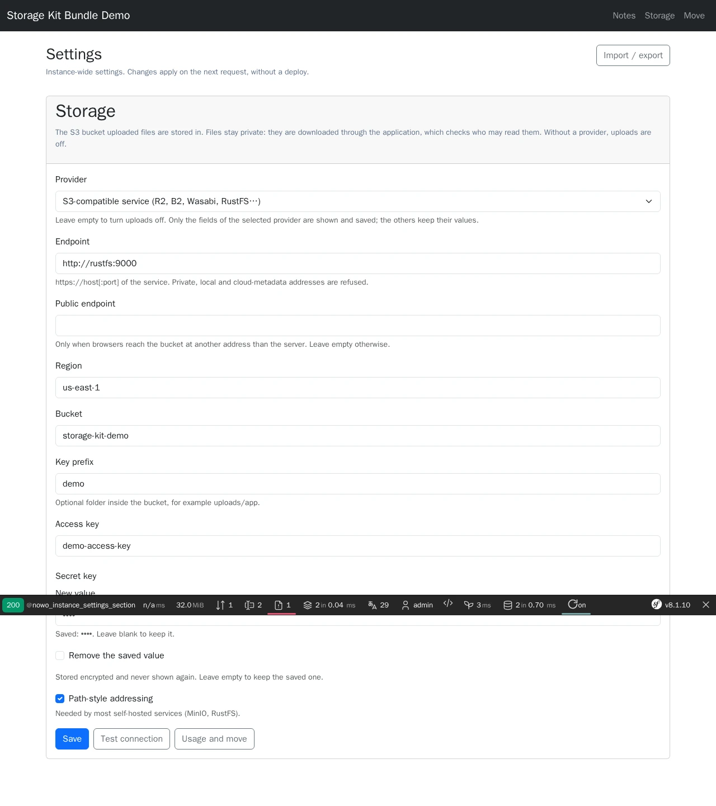
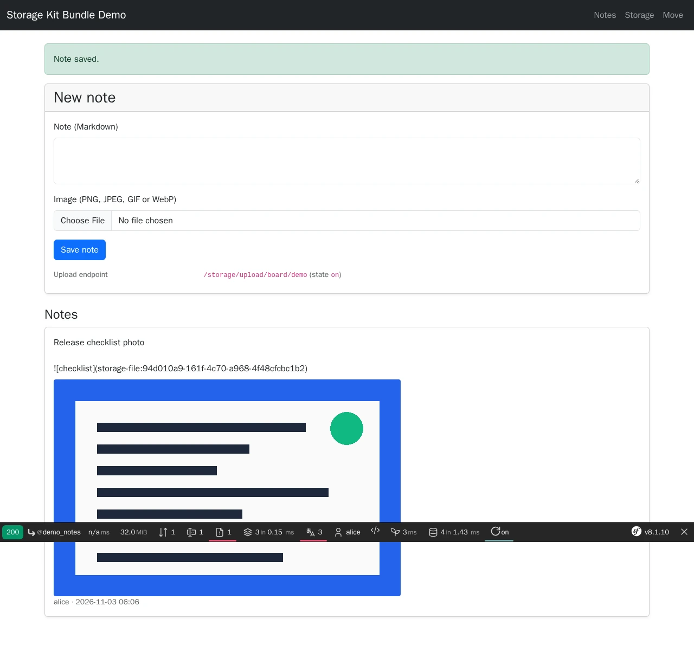
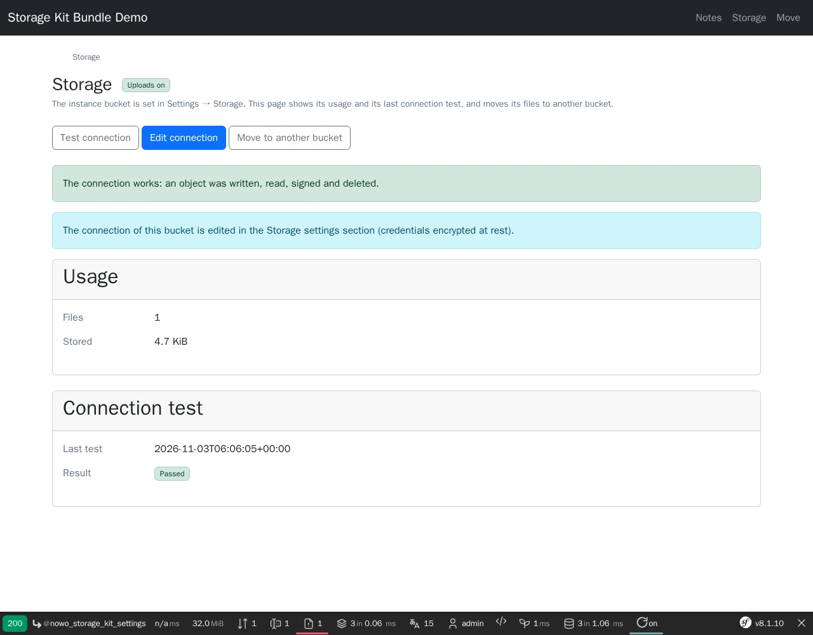
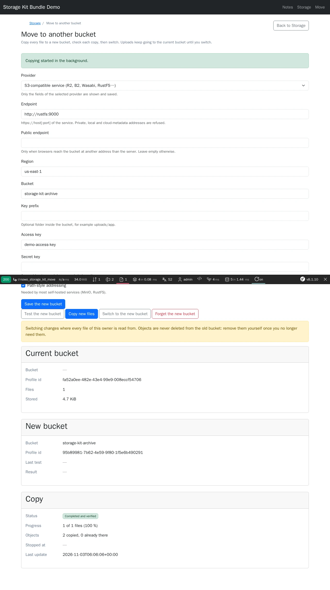

# Storage Kit Bundle

[](https://github.com/nowo-tech/StorageKitBundle/actions/workflows/ci.yml) [](https://packagist.org/packages/nowo-tech/storage-kit-bundle) [](https://packagist.org/packages/nowo-tech/storage-kit-bundle) [](LICENSE) [](https://php.net) [](https://symfony.com) [](https://github.com/nowo-tech/StorageKitBundle) [](#tests-and-coverage)

> ⭐ **Found this useful?** [Install from Packagist](https://packagist.org/packages/nowo-tech/storage-kit-bundle) · Give it a **star** on [GitHub](https://github.com/nowo-tech/StorageKitBundle) so more developers can find it.

**Storage Kit Bundle** — S3-compatible object storage for the images users paste into Markdown texts. The instance
bucket is a **`storage`** section of [Instance Settings](https://github.com/nowo-tech/InstanceSettingsBundle) (Amazon
S3 or any S3-compatible service — R2, B2, Wasabi, Scaleway, RustFS, MinIO —, secret encrypted at rest, **Test
connection**) or an ops-managed configuration profile; organisations or tenants can bring **their own bucket**.
Uploads are content-sniffed, size- and pixel-capped, re-encoded and stored under random keys in **private** buckets;
**your file contexts decide who writes and who reads**, downloads are streamed with a sandbox CSP (or redirected to a
short-lived pre-signed URL for configuration profiles), texts keep `storage-file:<uuid>` URIs, orphans are **purged**
after a retention, and a whole owner can be **moved to another bucket** with a SHA-256-verified, resumable copy and a
switch. Every bucket typed into a page goes through an **SSRF guard**. Tested on Symfony **7.4** and **8.1** · PHP 8.2+
(Symfony 8.x requires PHP 8.4+).


This bundle is **FrankenPHP worker mode friendly**.

Bucket connections, resolved profiles and per-viewer read decisions are request-scoped memos reset on `kernel.reset`
(and on a `storage` section change), so a bucket saved or switched in one request is used by the next one in every
worker. See [docs/FRANKENPHP-WORKER-AUDIT.md](docs/FRANKENPHP-WORKER-AUDIT.md).

## Screenshots

<table>
  <tr>
    <td align="center" width="50%">
      
      <br /><sub>Settings → Storage: only the selected provider's fields, secret encrypted and never shown again</sub>
    </td>
    <td align="center" width="50%">
      
      <br /><sub>An image uploaded into a note, stored in a private bucket and served through the application</sub>
    </td>
  </tr>
  <tr>
    <td align="center" width="50%">
      
      <br /><sub>Storage page: status, usage and a passed connection test</sub>
    </td>
    <td align="center" width="50%">
      
      <br /><sub>Move to another bucket: a completed and verified copy, ready to switch</sub>
    </td>
  </tr>
</table>

## Features

- **S3-compatible buckets** over Flysystem + async-aws — providers `aws_s3` (endpoint derived from the region) and
  `s3_compatible` (endpoint, public endpoint, path style); objects always private; no local-disk provider.
- **Instance bucket in Instance Settings** — the `storage` section (provider, endpoint, public endpoint, region, bucket,
  prefix, access key, encrypted write-only secret, path style), provider-dependent fields with `visible-when`, empty
  provider = uploads off, notices, **Test connection** (write, read, sign, public-read warning, delete) and **Usage and
  move**. For Amazon S3, the access key and secret can also come from the AWS console's access-key CSV (*Import from
  AWS CSV*, never stored). Credentials live in the database, encrypted; ops-managed infrastructure buckets can instead be pinned in the
  configuration (`profiles` + `instance_profile`, e.g. a DSN from an env var — ops-only).
- **Scope buckets** — `scopes.enabled` with your `ScopeResolverInterface` and `ScopeAccessCheckerInterface`: each
  organisation / tenant manages its own bucket on its Storage page (404 for everyone else); a turned-off scope bucket
  turns its uploads off, never falls back to someone else's.
- **Image uploads for Markdown editors** — `POST /storage/upload/{type}/{id}`: CSRF header, upload roles, per-user rate
  limit, PNG / JPEG / GIF / WebP by content (SVG and HTML refused), `max_bytes`, `max_pixels` before decoding, memory
  check, re-encoding (EXIF / GPS stripped), preview and thumbnail variants, random server-side keys, optional plan quota
  (`UploadLimitInterface`); answers the Markdown snippet ``. Twig helpers for
  MilkdownEditor and any other editor.
- **Host-decided access** — `FileContextInterface` says who may write in a context (and which scope / owner pays) and
  who may read it, batched per context type.
- **Downloads** — 404 for missing and forbidden alike; streamed with `nosniff`, a sandbox CSP and `attachment`, or `302`
  to a short-lived pre-signed URL (configuration profiles with `delivery: redirect`, origin added to the CSP through
  HttpHardening); `nowo_storage_images()` resolves a text's images for your renderer.
- **References and purge** — `FileReferenceSourceInterface` + a Doctrine flush listener track which text points at
  which file (same context only); `nowo:storage-kit:purge` deletes orphans after `purge.retention_days` in keyset
  batches.
- **Verified bucket moves** — Move page (or `nowo:storage-kit:sync`): SHA-256-verified, idempotent, resumable copy in
  Messenger slices; switch only after a complete copy with no upload since; the old bucket is retired, never emptied.
- **SSRF guard** — private / loopback / link-local / metadata / IPv4-mapped endpoints refused, DNS resolved with a
  deadline, connect-time filter without redirects, `endpoints.allowed_hosts` for internal services, `allow_private` in
  debug only.
- **No secret leaks** — credentials encrypted at rest (Instance Settings secret, DoctrineEncrypt), write-only fields,
  provider messages scrubbed and kept out of pages, audit events (`StorageAuditEvent`) with field names only; GDPR export
  / erasure hooks.
- **Admin UI** on the UiKit page contract (FormKit profile `storage_kit`, opt-in route loader, 7 locales) and
  **fail-closed wiring** (no DoctrineEncrypt, Instance Settings, CSRF or SecurityBundle when needed → no compile).

## Installation

```bash
composer require nowo-tech/storage-kit-bundle
```

With Symfony Flex the recipe adds `config/packages/nowo_storage_kit.yaml` and `config/routes/nowo_storage_kit.yaml`.
Without Flex, register `NowoDoctrineEncryptBundle`, `NowoUiKitBundle`, `NowoFormKitBundle`,
`NowoInstanceSettingsBundle` and `NowoStorageKitBundle` — see [docs/INSTALLATION.md](docs/INSTALLATION.md). Then:

```yaml
# config/routes/nowo_storage_kit.yaml (opt-in routes)
nowo_storage_kit:
    resource: .
    type: nowo_storage_kit

# config/routes/nowo_instance_settings.yaml (the "storage" section page)
nowo_instance_settings:
    resource: .
    type: nowo_instance_settings
```

Register the UiKit `visible-when` Stimulus peer (provider-dependent fields):

```js
import VisibleWhenController from '…/ui-kit-bundle/src/Resources/assets/stimulus-peers/visible_when_controller';
app.register('visible-when', VisibleWhenController);
```

Create the tables with a migration (`php bin/console doctrine:migrations:diff`) and protect the prefixes:

```yaml
# config/packages/security.yaml
security:
    access_control:
        - { path: ^/admin/storage, roles: ROLE_ADMIN }
        - { path: ^/admin/settings, roles: ROLE_ADMIN }
```

## Quick start

1. Open **Settings → Storage** (`/admin/settings/sections/storage`), choose a provider, fill in the bucket and press
   **Test connection**.
2. Tell the kit who may write and read, per kind of text:

```php
use Nowo\StorageKitBundle\Context\FileContextInterface;
use Nowo\StorageKitBundle\Context\FileContextTarget;

final class IssueContext implements FileContextInterface   // autoconfigured
{
    public function type(): string { return 'issue'; }
    public function readable(?object $viewer, array $ids): array { /* ids the viewer may read, one query */ }
    public function existing(array $ids): array { /* ids that still exist */ }
    public function writableTarget(object $user, string $id): ?FileContextTarget
    {
        return $this->canComment($user, $id) ? new FileContextTarget() : null;   // null scope = instance bucket
    }
}
```

3. Give the editor the upload endpoint and render the images:

```twig
{{ form_row(form.body, nowo_storage_milkdown_upload('issue', issue.id)) }}

   {# uuid => {src, original, width, height, alt} #}
```

4. Implement a `FileReferenceSourceInterface` for the texts and schedule `php bin/console nowo:storage-kit:purge`
   daily.

## Requirements

- PHP **8.2+** (`>=8.2 <8.6`, `ext-gd`; Symfony 8.x requires PHP 8.4+)
- Symfony **7.4**, **8.0** or **8.1** (FrameworkBundle with CSRF, Form, Validator, RateLimiter, HttpClient, Lock,
  TwigBundle; SecurityBundle for the admin pages)
- Doctrine ORM **3.3+**; `nowo-tech/doctrine-encrypt-bundle` **^2.10** (registered); `nowo-tech/instance-settings-bundle`
  **^1.3.1**; `nowo-tech/ui-kit-bundle` **^2.23**; `nowo-tech/form-kit-bundle` **^2.17**;
  `nowo-tech/outbound-url-guard-bundle` **^1.3**; `async-aws/s3` **^2.8 || ^3.0**; `league/flysystem` **^3.29**;
  `twig/extra-bundle`
- Optional: `symfony/messenger` (background moves), `nowo-tech/http-hardening-bundle` (CSP adapter),
  `nowo-tech/milkdown-editor-bundle` (Markdown editor)

## Configuration

Every key, its default and its validation are documented in [docs/CONFIGURATION.md](docs/CONFIGURATION.md), including
the `storage` section fields per provider. Safe defaults: instance bucket in Instance Settings, private endpoints
refused, 10 MiB / 24 MP uploads, 30 uploads per user and minute, `attachment` downloads, 7-day orphan retention, pages
under `/admin/storage` for `ROLE_ADMIN`, uploads for `ROLE_USER`.

## Usage

The instance bucket and providers, file contexts, uploading from an editor, rendering, downloads and CSP, references and
the purge, scope buckets, quotas, moving to another bucket, adopting an existing instance bucket
(`nowo:storage-kit:adopt-instance-bucket`), personal data and audit events: [docs/USAGE.md](docs/USAGE.md).

## Demo

- `demo/symfony8` — Symfony **8.1** (FrankenPHP PHP **8.5**, worker mode) with MySQL and **RustFS** (two private
  buckets); app on `http://localhost:8213` (users `admin` / `demo`, `alice` / `demo`). Notes with image uploads, the
  Storage and Move pages, a verified move to the archive bucket.

Runtime mode is **`FRANKENPHP_MODE`** (`worker` default, or `classic`) — see [docs/DEMO-FRANKENPHP.md](docs/DEMO-FRANKENPHP.md).

```bash
make -C demo up-symfony8          # http://localhost:8213
make -C demo/symfony8 setup       # encryption key, schema, buckets, demo bucket profile
make test-e2e                     # Playwright e2e against the running demo
make demo-screenshots             # refresh docs/images/demo/*.webp
make demo-smoke                   # boot, HTTP 200, down (REQ-TEST-011)
```

## Development

```bash
make up
make install
make test
make cs-check
make phpstan
make igor
make test-coverage-100
make release-check
```

## Documentation

- [Installation](docs/INSTALLATION.md)
- [Configuration](docs/CONFIGURATION.md)
- [Usage](docs/USAGE.md)
- [Contributing](docs/CONTRIBUTING.md)
- [Code of Conduct](CODE_OF_CONDUCT.md)
- [Changelog](docs/CHANGELOG.md)
- [Upgrading](docs/UPGRADING.md)
- [Release](docs/RELEASE.md)
- [Security](docs/SECURITY.md)
- [Engram](docs/ENGRAM.md)
- [Spec-driven development](docs/SPEC-DRIVEN-DEVELOPMENT.md)
- [GitHub Spec Kit](docs/SPEC-KIT.md)

### Additional documentation

- [Templates (UiKit page contract)](docs/TEMPLATES.md)
- [Architecture](docs/ARCHITECTURE.md)
- [Roadmap](docs/ROADMAP.md)
- [PSR evaluation (REQ-CS-007)](docs/PSR.md)
- [Demo (FrankenPHP)](docs/DEMO-FRANKENPHP.md)
- [FrankenPHP worker audit (kernel not reset)](docs/FRANKENPHP-WORKER-AUDIT.md)
- [GitHub Actions CI requirements](docs/GITHUB_CI.md)

## Tests and coverage

- Tests: PHPUnit (PHP) — unit tests (S3 settings and DSN parsing, SSRF guard, image processing, contexts, references,
  profiles, configuration) plus kernel integration tests (upload / download end to end on an in-memory bucket, the
  `storage` Instance Settings section, Storage and Move pages with SecurityBundle and CSRF, references and purge, sync
  and switch, opt-in routes, invalid configuration) and the UiKit page contract test; Playwright e2e and axe (WCAG 2.1 AA) checks on the demo
- PHP: 100% (2990/2990 statements, 3437/3437 elements, 290 tests; gate enforced in CI by `composer test-coverage-100`, no exclusions)
- TS/JS: N/A
- Python: N/A

## License and author

MIT · [Nowo.tech](https://nowo.tech) · [Héctor Franco Aceituno](https://github.com/HecFranco)
